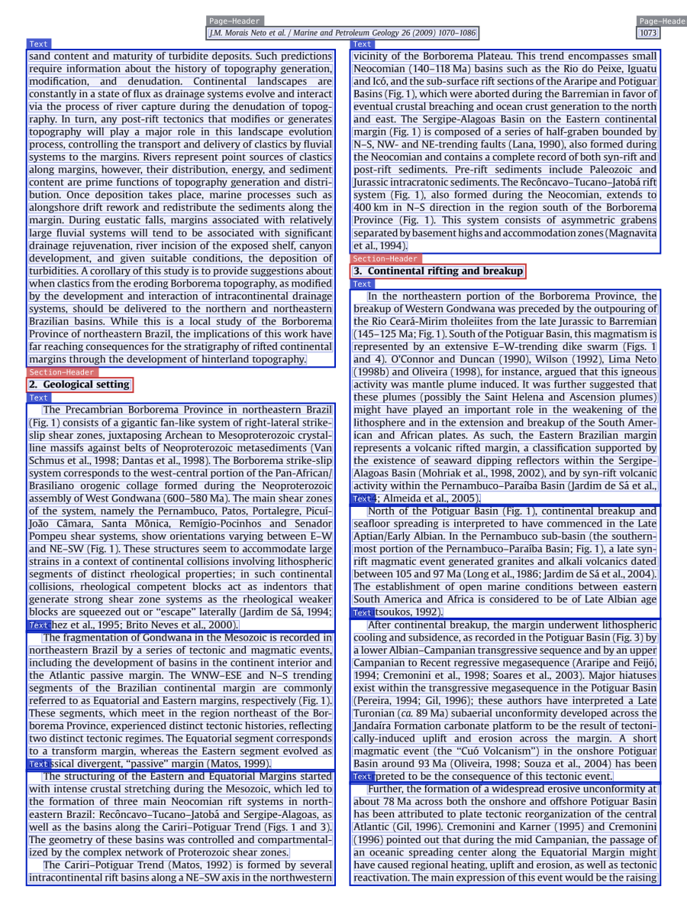
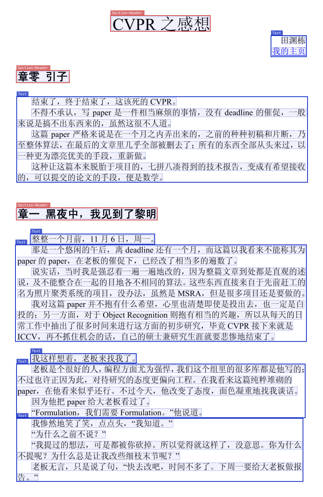

# Indra OCR examples

Real Indra OCR outputs on [OmniParseBench](https://github.com/datalab-to/omni_parse_bench) pages, from the v3 models with default settings (`--mode auto`, page headers and footers kept). The boxes are drawn from the JSON output: colored boxes are layout blocks with their label, faint blue boxes are lines. The outputs are not edited. The markdown excerpts are cut at "...". Back to the [README](README.md).

## Scanned upside down


A two-column annual report page, scanned upside down. Indra OCR turns the page upright (`rotation: 180`), then reads the columns in order and finds the headings. Source: OCR. OmniParseBench page `rotation_skew-rse11a9ca2_rot180-p1`.

```markdown
...

In 2021, we took what we had learned from both programs to launch our latest ini ...

## Sustainable Finance

Another area where we've long been focused is sustainability. We have been a lea ...
```

## Table


A journal page from a digital PDF with two tables. Indra OCR reads the text layer and outputs each table as HTML, with its caption. Source: PDF text layer. OmniParseBench page `tables_derived-PMC2564913.1_doc-p4`.

```markdown
...

Table 1: Background data for the 75-year old study participants (n = 154).

<table>
<tr><th></th><th>Atrial fibrillation</th><th>No atrial fibriallation</th><th>Chi-square/df/p or t/d.f/p</th></tr>
<tr><td>Gender (male/female)</td><td>34 (31.8%)/12 (25.5%)</td><td>73 (68.2%)/35 (74.5%)</td><td>0.608/1/0.44</td></tr>
<tr><td>BMI (kg/m2)</td><td>25.3 ± 3.7</td><td>25.4 ± 3.2</td><td>-0.176/145/0.86</td></tr>
<tr><td>Waist (cm)</td><td>93.5 ± 11.7</td><td>91.6 ± 10.9</td><td>0.936/151/0.35</td></tr>
<tr><td>SBP (mmHg)</td><td>143 ± 21</td><td>147 ± 16</td><td>-1.169/152/0.24</td></tr>
<tr><td>DBP (mmHg)</td><td>82 ± 10</td><td>81 ± 9</td><td>1.069/152/0.29</td></tr>
...
```

## Two columns and headings



A two-column journal page from a digital PDF. Indra OCR reads the text layer, orders the columns, and finds the section headings. Source: PDF text layer. OmniParseBench page `olmo_multi_column-0845863d27c84b14011e17a388821525e783_page_4_pg1-p1`.

```markdown
sand content and maturity of turbidite deposits. Such predictions requ ...

## 2. Geological setting

The Precambrian Borborema Province in northeastern Brazil (Fig. 1) con ...

The fragmentation of Gondwana in the Mesozoic is recorded in northeast ...

The structuring of the Eastern and Equatorial Margins started with int ...

vicinity of the Borborema Plateau. This trend encompasses small Neocom ...

...
```

## Chinese



A typeset Chinese essay, read by OCR with the Chinese recognizer, with its headings. Source: OCR. OmniParseBench page `multiling_finepdfs-images_cmn_Hani_54743253-p1`.

```markdown
## CVPR 之感想

田渊栋我的主页

## 章零 引子

结束了，终于结束了，这该死的 CVPR。不得不承认，写 paper 是一件相当麻烦的事情， ...

## 章一 黑夜中，我见到了黎明

整整一个月前，11 月 6 日，周一。

...
```
