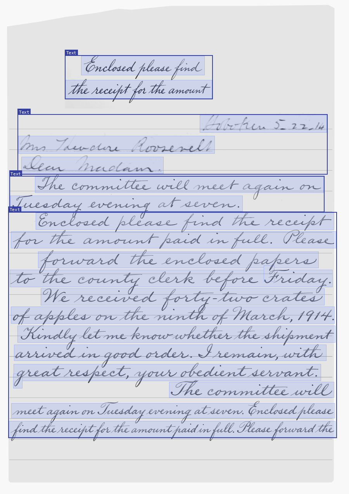
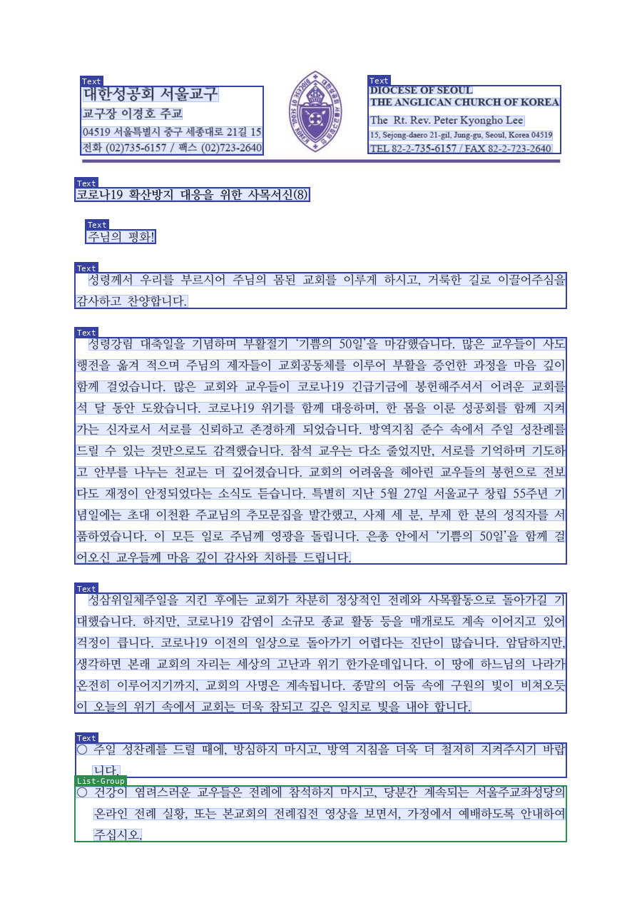
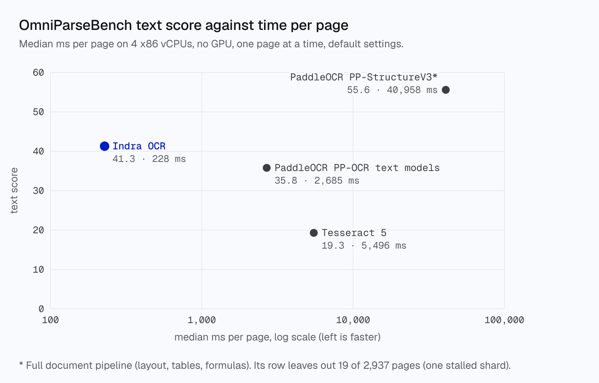

<p align="center">
  
</p>
<h1 align="center">Datalab</h1>
<p align="center">
  <strong>State of the Art models for Document Intelligence</strong>
</p>
<p align="center">
  <a href="https://opensource.org/licenses/Apache-2.0"></a>
  <a href="https://www.datalab.to/pricing"></a>
  <a href="https://discord.gg/KuZwXNGnfH"></a>
  <a href="https://huggingface.co/datalab-to/indra-ocr"></a>
</p>
<p align="center">
  <a href="https://www.datalab.to"></a>
  <a href="https://documentation.datalab.to"></a>
  <a href="https://www.datalab.to/playground"></a>
</p>

<hr/>

# Indra OCR

Indra OCR is a compact OCR pipeline that runs on CPU. It turns PDFs and images into markdown, text, or JSON with boxes, and it reads handwriting, 80+ languages, and pages at any angle.

- **Accurate** - 78.9 on [OmniParseBench](https://github.com/datalab-to/omni_parse_bench) with math enabled (the default), or 71.6 with `--no-math`. See the versioned [benchmarks](#benchmarks).
- **CPU-first** - ONNX Runtime, no PyTorch or GPU required. Use multiple processes for batch conversion.
- **80+ languages** - Latin-script languages, Russian and the Cyrillic languages, Greek, Chinese, Japanese, Korean, Arabic, Persian, Urdu, Hebrew, Hindi and the Indic languages, Thai, Khmer and more ([languages](#languages))
- **Handwriting** - handwritten pages and forms; cursive and faint pencil remain difficult (see [limitations](#limitations))
- **Real-world scans** - sideways, upside down, tilted up to 45 degrees, light text on dark ground
- **Layout** - a box, a label and a reading order for every line and block (headings, lists, tables, captions, footnotes, page headers)
- **Digital PDFs** - reads the text layer in any script, and OCRs only what is missing
- **Small** - ONNX Runtime, no PyTorch, no GPU

Indra OCR is named for [Indra](https://en.wikipedia.org/wiki/Indra).

<!-- The historical throughput measurements are documented below. -->

## Try Datalab's Managed Platform

Indra OCR is built for speed on CPUs. When you need the highest accuracy, on handwriting, math, complex tables and degraded scans, our managed platform uses [Chandra](https://github.com/datalab-to/chandra), our state of the art OCR model, and other models, with opt-in zero data retention, SOC 2 Type 2, and custom BAAs.

If you have high volume workloads, we offer a batch processing service that has processed 1B+ pages in a day at peak.

The Datalab API turns documents into verifiable knowledge your agents act on. Every result traces back to its page and position, and one API can parse, extract, fill and edit documents.

Get started with **about 5,000 free convert pages every month** (work email) - [sign up](https://www.datalab.to/?utm_source=gh-indra) - or try Chandra in our [public playground](https://www.datalab.to/playground?utm_source=gh-indra).

## Quickstart

```shell
pip install indra-ocr

indra-ocr paper.pdf                    # markdown to stdout
indra-ocr *.pdf --out results/         # one .md per input, all cores
indra-ocr scan.png --format json       # lines, boxes, layout blocks, confidences

indra-ocr-viewer                       # local web viewer on http://localhost:8765
```

The first run downloads the models (about 114 MB with math enabled) from [Hugging Face](https://huggingface.co/datalab-to/indra-ocr).

## Examples

Real Indra OCR outputs on OmniParseBench pages. Colored boxes are layout blocks with their label, faint blue boxes are lines, drawn from the JSON output with no edits.

<table>
<tr>
<td width="50%"><br/><sub>A handwritten letter in cursive: Indra OCR finds every line and reads the body of the letter.</sub></td>
<td width="50%"><br/><sub>A scanned Korean letter: each line goes to the recognizer for its script.</sub></td>
</tr>
</table>

**[See more examples, with the markdown output for each →](https://github.com/datalab-to/indra/blob/main/EXAMPLES.md)**


# License

Indra OCR has two parts with two licenses:

| Part | Where it comes from | License |
|---|---|---|
| Code (this repository, the `indra-ocr` package) | GitHub, PyPI | [Apache 2.0](LICENSE) |
| Model weights (the `.onnx`, `.npz` and `.json` model files) | [Hugging Face](https://huggingface.co/datalab-to/indra-ocr), downloaded on the first run | Modified OpenRAIL-M: [MODEL_LICENSE](MODEL_LICENSE), the same text as the [Hugging Face license](https://huggingface.co/datalab-to/indra-ocr/blob/main/LICENSE) |

GitHub shows only Apache 2.0 because it reads the `LICENSE` file. The Apache 2.0 license does not cover the model weights. To use Indra OCR, you need both: the code under Apache 2.0, and the weights under the model license. See [Commercial usage](#commercial-usage) for what the model license allows.

# Commercial usage

This code is Apache 2.0, and our model weights use a modified OpenRAIL-M license (free for research, personal use, and startups under $5M funding/revenue, cannot be used competitively with our API). To remove the OpenRAIL license requirements, or for broader commercial licensing, visit our pricing page [here](https://www.datalab.to/pricing?utm_source=gh-indra).

# Installation

```shell
pip install indra-ocr
```

The default model download is about 114 MB, including math. Use `--no-math` or `load(math=False)` to skip the math readers. The models include recognizers for each script group, layout and table models, and language models.

For the latest code from GitHub instead: `pip install git+https://github.com/datalab-to/indra.git`. To let the viewer compare with Tesseract, install `pip install "indra-ocr[tesseract]"` and a Tesseract binary.

Python 3.10 or newer, tested on Linux (x86_64 and aarch64, Python 3.10 to 3.13) and macOS (Apple silicon). It installs ONNX Runtime, OpenCV and pypdfium2, and no PyTorch. The models download from Hugging Face on the first run and are cached. To use a local copy, set `INDRA_OCR_MODEL_DIR` or pass `--model-dir`.

# Usage

## CLI

```shell
indra-ocr paper.pdf                       # markdown to stdout
indra-ocr *.pdf --out results/            # one .md per input
indra-ocr scan.png --format json          # lines, boxes, layout blocks, confidences, timings
indra-ocr paper.pdf --format text         # plain text, one line per detected line
indra-ocr paper.pdf --mode ocr --timings  # ignore the text layer, OCR every page; timings on stderr
indra-ocr paper.pdf --keep-furniture      # keep page headers and footers in the markdown
indra-ocr *.pdf --out results/ --cores 8  # limit the cores (default: all usable cores)
indra-ocr paper.pdf --no-math             # skip math recognition and its models
```

**CLI Options:**
- `--out DIR`: write one file per input (`.md`, `.txt` or `.jsonl`)
- `--format [md|text|json]`: output format (default: md)
- `--mode [auto|ocr|text]`: `auto` reads the text layer where it passes the checks and OCRs elsewhere (default). `ocr` never reads the text layer. `text` uses the text layer even when the checks fail
- `--no-image-ocr`: on text-layer pages, do not OCR text inside images
- `--cores N`: cores to use, one worker process each (default: all usable cores)
- `--dpi`: render resolution for PDFs (default: 200)
- `--max-pages N`: read at most N pages per file
- `--password`: password for encrypted PDFs
- `--keep-furniture`: keep page headers and footers in the markdown
- `--math` / `--no-math`: write math as LaTeX (`$...$`); on by default, see [Math](#math)
- `--words`: include word text and boxes in JSON output
- `--timings`: print per-page source and time to stderr
- `--model-dir`: folder with the models (default: download)

The CLI continues past files it cannot read, and exits with 1 if any failed.

## From python

```python
import indra_ocr

conv = indra_ocr.load(threads=4)          # mode="auto" | "ocr" | "text"
for i, page in conv.convert("paper.pdf"):
    print(page.source, page.timings["total_ms"])
    print(page.markdown)                  # headings, lists, tables as HTML
    page.blocks                           # [{"label", "bbox", "text"}] in reading order
    page.lines                            # [Line(box, text, conf)] in reading order
```

An image file works the same way as a PDF (PNG, JPEG, TIFF, BMP, WebP; one page per TIFF frame). For an image already in memory, pass a grayscale `uint8` numpy array to `conv.ocr`:

```python
import cv2
import indra_ocr

conv = indra_ocr.load(threads=4)
for i, page in conv.convert("scan.png"):  # an image file
    print(page.text)

gray = cv2.cvtColor(cv2.imread("photo.jpg"), cv2.COLOR_BGR2GRAY)
page = conv.ocr(gray)                     # an image in memory
print(page.markdown)
```

Runnable examples: [`examples/ocr_image.py`](examples/ocr_image.py) (one image to markdown, text or JSON with boxes) and [`examples/quickstart.ipynb`](examples/quickstart.ipynb).

For many pages or files, `convert_many` runs one single-threaded worker process per core, one page per task, and returns results in input order:

```python
import indra_ocr

if __name__ == "__main__":                # worker processes re-import this file
    for path, result in indra_ocr.convert_many(["a.pdf", "b.pdf"], cores=None):
        if isinstance(result, indra_ocr.InputError):
            continue                      # unreadable or locked file
        for i, page in result:
            print(path, i, page.source)
```

Without the `if __name__ == "__main__":` guard (needed on macOS and Windows), `convert_many` warns and reads everything in one process.

`indra_ocr.load` takes `path` (model folder), `threads`, `dpi`, `mode`, `image_ocr`, `furniture`, `math` and `device`. `conv.convert` takes `max_pages` and `password`.

## GPU

```shell
pip install "onnxruntime-gpu[cuda,cudnn]"            # instead of onnxruntime
TENSORRT_ROOT=/path/to/TensorRT-11 pip install ./cuda  # optional: the GPU engine
```

```python
conv = indra_ocr.load(device="cuda")      # or "cuda:1"
```

```shell
indra-ocr paper.pdf --device cuda --cores 16   # 16 worker processes share the GPU
```

With `device="cuda"` the models run on the optional GPU engine (`cuda/`, the `indra-ocr-cuda` package: TensorRT engines on fixed device buffers, the recognizers' logits and the math decoder's caches kept on the GPU) where it is installed, and on ONNX Runtime's CUDA provider otherwise. The engine builds each model's TensorRT engine the first time it loads (10 to 40 seconds each) and caches it (`INDRA_TRT_CACHE`, default `~/.cache/indra-ocr/trt`). Pages read on the GPU can differ from the CPU's in a few characters (float rounding): 0.001% of the characters on 300 OmniParseBench pages. Throughput grows with worker processes, as on the CPU.

## Viewer

```shell
indra-ocr-viewer --port 8765              # open http://localhost:8765
```

A local web viewer: drop in a PDF or an image, and each page shows its lines, layout blocks and reading order over the page, with the rendered markdown, the markdown source, the lines with their confidences, the JSON output and the time of each stage. The pipeline options (text layer or OCR, math, headers and footers, reading order, OCR of text inside images, dpi, page limit) are set in the page, and lines, blocks, block labels and reading order can each be shown or hidden. Files stay on your machine. `--tesseract` lets the page compare with Tesseract (needs `pytesseract` and a Tesseract install). Over SSH, forward the port: `ssh -N -L 8765:localhost:8765 host`.

## Output

Every page is a `Page` with:

- `markdown`: headings (`##`), paragraphs, lists, and tables as HTML. Page headers and footers are left out unless `furniture=True` / `--keep-furniture`
- `text`: one line per detected line, in reading order
- `lines`: `Line(box, text, conf)`, box is `x0, y0, x1, y1` in image pixels
- `blocks`: layout blocks in reading order, `{"label", "bbox", "text"}`
- `source`: `text` (PDF text layer), `ocr`, `hybrid` (text layer + OCR of text inside images) or `error`
- `rotation`, `skew`: the quarter or half turn applied (degrees), and the small tilt straightened
- `vertical`: the page is set in vertical columns (Chinese, Japanese): it was read turned a quarter turn, and its boxes are on the page as it is
- `timings`: per-step milliseconds, with `total_ms`
- `note`: why the page took its path

Block labels: `Text`, `Section-Header`, `Page-Header`, `Page-Footer`, `List-Group`, `Table`, `Caption`, `Footnote`, `Table-Of-Contents`, `Form`. `--format json` writes one JSON object per page with all of these fields.

# Languages

**OCR (scans and images):** we measured 95 languages on held-out printed pages: 83 read at character F1 0.90 or higher, and 67 at 0.95 or higher. Four recognizers, and a line classifier that sends each line to one of them:

- `rec.onnx`: Latin (about 50 languages, with the letters of Hausa, Fula, Akan, Azerbaijani and Uzbek and the tone marks of Vietnamese and Yoruba), Cyrillic, Greek, and handwriting in Latin script.
- `rec_cjk.onnx`: Chinese (simplified and traditional), Japanese (kana and kanji), Korean.
- `rec_rtl.onnx`: Arabic, Persian, Urdu, Pashto, Kurdish, Hebrew. Lines come out in logical order, and a right-to-left page reads its right column first.
- `rec_world.onnx`: Devanagari (Hindi, Marathi, Nepali), Bengali, Tamil, Telugu, Kannada, Malayalam, Gujarati, Gurmukhi, Odia, Thai, Lao, Khmer, Myanmar, Sinhala, Georgian, Armenian, Ethiopic.

When the classifier is not sure of a line, the main recognizer reads it too, and the more confident reading wins.

OmniParseBench, per script (tests in parentheses):

| Script | Score | Script | Score |
|---|---|---|---|
| Latin (9,406) | 61.6 | Thai (39) | 87.2 |
| Chinese (136) | 64.0 | Lao (52) | 96.2 |
| Korean (24) | 79.2 | Khmer (34) | 70.6 |
| Japanese kana (19) | 57.9 | Tamil (25) | 84.0 |
| Devanagari (23) | 69.6 | Telugu (33) | 87.9 |
| Bengali (40) | 77.5 | Kannada (48) | 93.8 |
| Arabic (13) | 69.2 | Malayalam (40) | 65.0 |
| Hebrew (30) | 80.0 | Gujarati (15) | 80.0 |
| Georgian (14) | 100 | Gurmukhi (31) | 64.5 |
| Armenian (60) | 100 | Ethiopic (43) | 100 |

Most scripts have few tests, so one test moves a score by 2 to 8 points. On [OmniDocBench](https://github.com/opendatalab/OmniDocBench) v1.5 (OCR only, 1,651 pages, our run without the formula metric), the text edit distance is 0.114 on English pages and 0.237 on simplified Chinese pages (lower is better), and table TEDS is 0.47.

**Vertical text.** Chinese and Japanese pages set in vertical columns are read turned a quarter turn, so each column is a line for the CJK recognizer. Scans are found by the orientation model, digital PDFs by their text layer. `page.vertical` is set, and boxes are on the page as it is.

**Text layer (digital PDFs): any script.** We checked text mode on 1,125 pages from 75 language families. On pages whose layer passes the checks, Indra OCR keeps at least 98% of the layer's characters in every family, including Arabic, Hebrew, Persian, Urdu, Thai, Khmer, Lao, Myanmar, Georgian, Armenian, Ethiopic, the Indic scripts, Chinese, Japanese and Korean. Right-to-left lines keep their right-to-left order.

# Limitations

Indra OCR is built for speed on clean print. It is not the right tool for:

- **Complex tables.** Tables with merged or spanning cells, cell text that wraps over several lines, nested headers, or no ruling lines can come out with cells in the wrong rows or columns. Simple grid tables read well.
- **Handwriting.** Handwritten pages remain less reliable than printed text. Cursive and faint pencil read worst.
- **Scripts outside the OCR list.** Syriac, Tibetan, Mongolian, Santali, Meitei and other scripts not listed under [Languages](#languages) work only through a digital PDF's text layer. Khmer and Malayalam OCR are fair (65 to 71 on OmniParseBench). Written Cantonese characters (嘅 咗 冇) are not in the Chinese recognizer.
- **Latin languages with many diacritics.** Some of them (Kurmanji, Czech, Lithuanian, Icelandic, Turkish, Slovak) read less well: the recognizer sometimes writes a close diacritic instead of the right one (ñ for ň, ú for ů, é for ė). English, French, German and Spanish are not affected.
- **Degraded scans.** Old, faded or low-resolution scans read poorly (29.5% on the OmniParseBench degraded-scan tests).

Also:

- Math recognition is on by default. With `--no-math`, formulas remain text-recognizer output (see [Math](#math)).
- Vertical pages read their columns right to left and their tiers top to bottom; a newspaper whose articles wind across tiers can come out in the wrong article order. Vertical scans read less well than horizontal ones.
- Very wide, banner-shaped pages read poorly.
- Labels inside engineering drawings often come out as small tables.
- Pages above 100 megapixels at 200 dpi render at a lower dpi, so small text on them can be lost.

For these documents, [Chandra on Datalab](https://www.datalab.to/?utm_source=gh-indra) is the accurate option.

# Math

Math recognition is on by default in 1.2.0. A small classifier identifies candidate lines; a math reader writes formulas as inline LaTeX while keeping surrounding prose from the text reader. A read gate and an accept model reduce unnecessary reads and false formulas. An image span tagger handles inline formulas in non-Latin text.

Use `indra-ocr paper.pdf --no-math` or `indra_ocr.load(math=False)` to disable math recognition and skip its model downloads. `--math-spans` also reads inline math inside native PDF text-layer lines, and `--math-rescore` enables a slower beam-search fallback; both remain off by default.

Math can increase conversion time: see [Throughput, 1.2.0 against 1.1.2](#throughput-120-against-112).

# Benchmarks

## Indra OCR 1.2.0

Full OmniParseBench (2,937 pages, 16,288 tests), run with the benchmark's own harness, Indra OCR adapter and scorer (omni-parse-bench 1.7.0, dataset commit `d70182b9`), default settings: auto mode, 200 dpi, page headers and footers kept. The headline is the mean of the text, tables and layout families.

| Version and settings | headline | text | tables | layout |
|---|---:|---:|---:|---:|
| **1.2.0, math enabled (default)** | **78.9** | **68.0** | 75.9 | 92.7 |
| 1.2.0, `--no-math` | 71.6 | 45.7 | **76.0** | **93.0** |
| 1.1.2, default | 71.4 | 62.6 | 59.6 | 92.1 |

Both 1.2.0 rows include the full test suite: disabling the math reader does not remove math-labelled tests. Against 1.1.2, most of the gain is in tables (+16.3) and text (+5.4). The OmniParseBench leaderboard lists an earlier Indra OCR run at 69.5; neither 0.3.2 nor 1.1.2 reproduces it with the current harness.

### Throughput, 1.2.0 against 1.1.2

Pages per second with the published method (one single-threaded worker per core, one page per task, OCR mode, the same 300 OmniParseBench pages), mean of 3 interleaved runs. Both versions ran in one container (34 CPUs, AMD EPYC family 25 model 1), not on the Genoa machine type of the historical table below, so compare the rows with each other only.

| version and settings | 4 cores | 8 cores | 16 cores | 32 cores |
|---|---:|---:|---:|---:|
| 1.1.2, default | 4.82 | 9.15 | 17.27 | 30.14 |
| 1.2.0, math enabled (default) | 3.77 | 7.21 | 13.15 | 20.82 |
| 1.2.0, `--no-math` | 4.43 | 8.31 | 15.88 | 25.79 |

Most of the extra time is the math reader, which reads the lines it flags as math; this page sample has many math-heavy pages. With `--no-math`, 1.2.0 has 8-14% lower throughput than 1.1.2, mainly from the new table structure model.

## Historical comparisons (Indra OCR 1.1.0)

The tables, charts and timing measurements below use 1.1.0 and its model set, with an earlier benchmark version (omni-parse-bench 1.0.0rc1, dataset revision `961c0f89`). They are kept because the other engines' runs saved only their per-test results and cannot be re-scored with the current version. Compare engines within one table, not across tables.


## OmniParseBench

[OmniParseBench](https://github.com/datalab-to/omni_parse_bench) has 16,288 pass/fail tests on 2,937 pages. The headline is the mean of the text, tables and layout families. All runs: x86, 4 vCPUs per engine, one page at a time, every engine on the same pages with the same scorer and its default settings.



| engine | headline | text | tables | layout | median ms / page |
|---|---|---|---|---|---|
| Indra OCR (auto: text layer + OCR) | 66.7 | 46.7 | **61.1** | **92.2** | **212** |
| Indra OCR (OCR only)‡ | 61.2 | 40.7 | 52.7 | 90.3 | 344 |
| Indra OCR `--math` (auto) | **71.4** | **62.7** | 59.6 | 92.0 | 357 |
| PaddleOCR PP-OCRv6 small, text models only (RapidOCR) | – | 35.8 | 0.0 | – | 2,685 |
| PaddleOCR PP-StructureV3 (2,918 pages\*) | 58.4 | 55.6 | 47.8 | 71.7 | 40,958 |
| Tesseract 5 (our run, Latin model) | – | 19.3 | 0.0 | – | 5,496 |

- Indra OCR's accuracy comes from the benchmark's own Indra OCR adapter and scorer (omni-parse-bench 1.0.0rc1, dataset revision 961c0f89), as on the OmniParseBench leaderboard. ‡The OCR-only row and the other engines come from our runs of the same pages and scorer. The median ms column comes from the x86 run below.
- The PP-OCR text models and Tesseract output lines, not tables or layout blocks, so their table scores are 0 and their layout family is not scored.
- PP-StructureV3 is PaddleOCR's full document pipeline (layout, tables, formulas). Without `--math`, it reads text better than Indra OCR (55.6 vs 46.7). With `--math`, Indra OCR is ahead on text too (62.7). It takes about 190 times as long per page as Indra OCR's default mode. \*One of its 150 shards stalled for 6 hours on its first page, so its row leaves out 19 pages.
- Faster settings exist, but we did not score their accuracy. Tesseract with the `eng` model and 1 thread takes 3.4 s a page (6.1 s as run). PP-StructureV3 without formula, seal and chart recognition, unwarping and orientation, and with its mobile OCR models, takes 10.5 s a page. Indra OCR is still 16-50x faster per page.
- The OmniParseBench leaderboard's own Tesseract run scores 17.6 on text.
- Median latency varies by about 15% between runs of the same code, so compare engines within one run. The Indra OCR rows come from one run. The other engines ran earlier, on the same container type and pages.

**Chinese** (136 OmniParseBench Chinese tests): Indra OCR 64.0, PaddleOCR PP-OCRv5 mobile Chinese text models 65.4, PP-StructureV3 68.4.

## olmOCR-bench

Born-digital splits and old scans, our harness, 200 dpi:

| split | Indra OCR | Tesseract 4 |
|---|---|---|
| headers_footers | 91.2 | 35.5 |
| multi_column | 70.0 | 70.4 |
| long_tiny_text | 67.9 | 64.0 |
| table_tests | 60.5 | 1.0 |
| old_scans | 20.0 | 18.4 |

## Throughput

The CLI and `convert_many` run one single-threaded worker process per usable core, one page per task, so a single long PDF also uses every core. `--cores` limits it.

Pages per second on x86 (AMD EPYC 9004 Genoa, 34 cores, no GPU), on the same 300 OmniParseBench pages, with one single-threaded worker per core, OCR mode and default settings. The other engines ran once on the same machine type and pages.

| engine | 4 cores | 8 cores | 16 cores | 32 cores |
|---|---|---|---|---|
| Indra OCR | **6.2** | **11.9** | **23.7** | **43.9** |
| PaddleOCR PP-OCRv6 small, text models only (RapidOCR) | 0.65 | 1.24 | 2.42 | 4.28 |
| Tesseract 5 | 0.78 | 1.37 | 2.27 | 2.92 |
| PaddleOCR PP-StructureV3\* | ≤ 0.022 | ≤ 0.044 | ≤ 0.089 | ≤ 0.18 |

At 32 cores, Indra OCR is 10x PaddleOCR's PP-OCR text models and 15x Tesseract. \*PP-StructureV3 ran a time-capped subset of other OmniParseBench pages in an earlier run, so its numbers are upper bounds.

Throughput depends on the CPU: on other x86 container types we measured 25 to 51 pages per second at 32 cores.

Model loading and one warm-up page per worker are not timed.

## Reproducing

```shell
git clone https://github.com/datalab-to/indra.git && cd indra
pip install indra-ocr 'omni-parse-bench[benchmark]'
python bench/opb_indra.py --out runs/opb_auto --mode auto --procs 8
```

Each page runs in a single-threaded worker process, page headers and footers kept. `--mode ocr` gives the OCR-only row, `--math` the `--math` row, `--suites` scores only the listed suites, `--limit N` scores the first N pages, and `--models` points at a local model folder. The run writes `summary.json` (the benchmark's own summary, plus median and p90 ms per page) and `pages.jsonl` (per page: time, source, tests passed). The tables above come from our x86 harness, which gives each page 4 threads. This script gives each page one thread, so its times differ, and its scores can differ by a few tenths of a point.

# Credits

Thank you to the following open source projects:

- [ONNX Runtime](https://github.com/microsoft/onnxruntime)
- [pypdfium2](https://github.com/pypdfium2-team/pypdfium2)
- [OpenCV](https://github.com/opencv/opencv)
- [Hugging Face Hub](https://github.com/huggingface/huggingface_hub)
