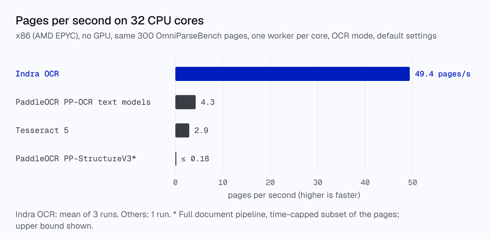
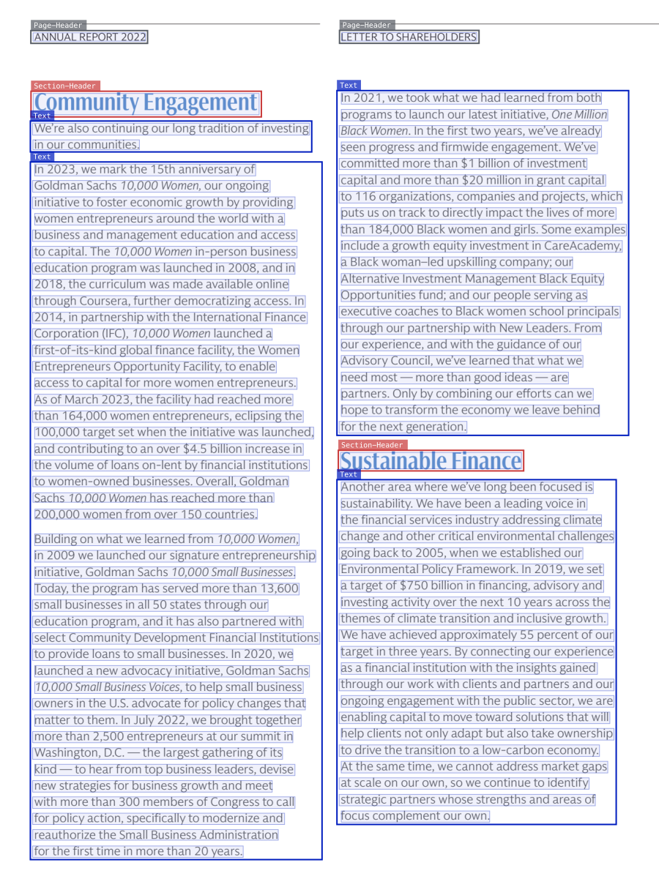
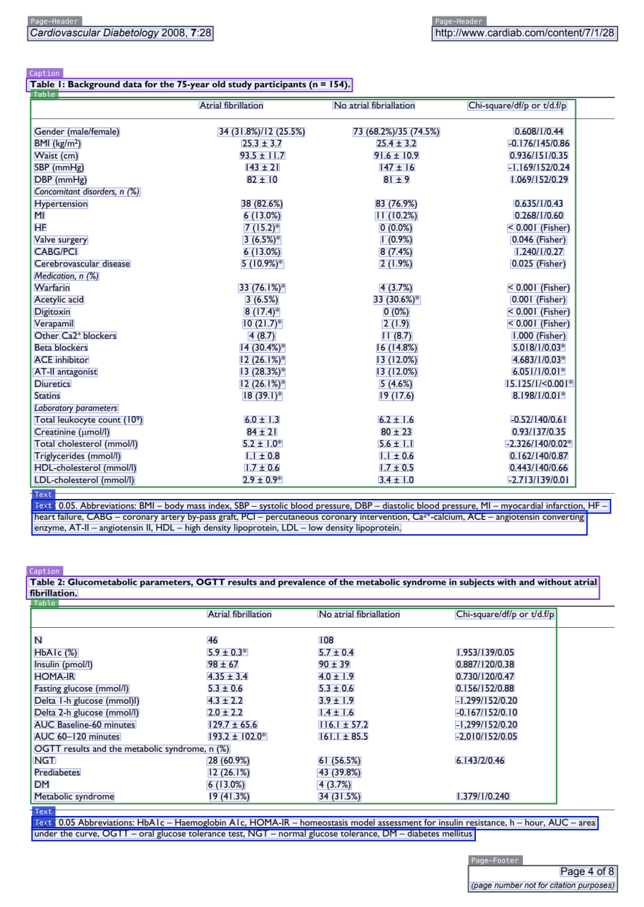
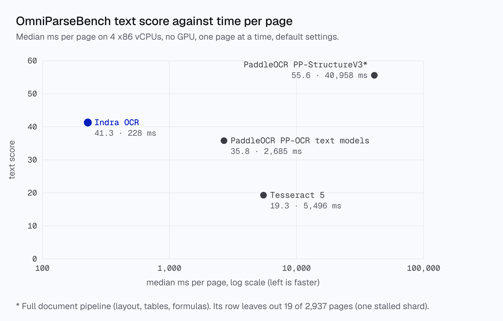

<p align="center">
  
</p>
<h1 align="center">Datalab</h1>
<p align="center">
  <strong>State of the Art models for Document Intelligence</strong>
</p>
<p align="center">
  <a href="https://opensource.org/licenses/Apache-2.0"></a>
  <a href="https://www.datalab.to/pricing"></a>
  <a href="https://discord.gg/KuZwXNGnfH"></a>
  <a href="https://huggingface.co/datalab-to/indra-ocr"></a>
</p>
<p align="center">
  <a href="https://www.datalab.to"></a>
  <a href="https://documentation.datalab.to"></a>
  <a href="https://www.datalab.to/playground"></a>
</p>

<hr/>

# Indra OCR

Indra OCR is a 1M-parameter OCR model that reads 49 pages per second on 32 CPU cores, with no GPU. It turns PDFs and images into markdown, plain text, or JSON with boxes, and it has these features:

- Throughput - 49 pages/s on 32 x86 CPU cores (AMD EPYC), 11-17x Tesseract and PaddleOCR's PP-OCR text models on the same machine and pages ([table](#throughput))
- Latency - ~230 ms per page on 4 x86 vCPUs, 12-24x faster than Tesseract and PaddleOCR's PP-OCR text models
- Accuracy - scores 41.3 on [OmniParseBench](https://github.com/datalab-to/omni_parse_bench) text, ahead of PaddleOCR's PP-OCR text models (35.8) and Tesseract (19.3). Its headline score (62.1) beats PaddleOCR's full PP-StructureV3 pipeline (58.4).
  - with `--math`: 66.8 headline and 57.5 text, ahead of PaddleOCR's PP-StructureV3 on every score ([Math](#math))
- Layout and boxes - a bounding box for every line and every layout block, with block labels (headings, lists, tables, captions, footnotes, page headers) and reading order
- Digital PDFs - reads the PDF's own text layer in any script, and OCRs only what the layer does not hold
- Small - about 18 MB of models on ONNX Runtime, no PyTorch

The main recognizer, `rec.onnx`, has about 1.24M parameters. See [benchmarks](#benchmarks) for the full results and [limitations](#limitations) for what it does not do yet.

Indra OCR is named for [Indra](https://en.wikipedia.org/wiki/Indra), the Hindu god who wields the thunderbolt.



## Try Datalab's Managed Platform

Indra OCR is built for speed on CPUs. When you need the highest accuracy, on handwriting, math, complex tables and degraded scans, our managed platform runs [Chandra](https://github.com/datalab-to/chandra), our state of the art OCR model, with zero data retention by default, SOC 2 Type 2, and custom BAAs.

If you have high volume workloads, we offer a batch processing service - we manage the infrastructure so your workloads finish on time.

Get started with **$5 in free credits** - [sign up](https://www.datalab.to/?utm_source=gh-indra) - or try Chandra in our [public playground](https://www.datalab.to/playground?utm_source=gh-indra).

## Quickstart

```shell
pip install git+https://github.com/datalab-to/indra.git

indra-ocr paper.pdf                    # markdown to stdout
indra-ocr *.pdf --out results/         # one .md per input, all cores
indra-ocr scan.png --format json       # lines, boxes, layout blocks, confidences

indra-ocr-viewer                       # local web viewer on http://localhost:8765
```

The first run downloads the models (about 18 MB) from [Hugging Face](https://huggingface.co/datalab-to/indra-ocr).

## Examples

Real Indra OCR outputs on OmniParseBench pages. Colored boxes are layout blocks with their label, faint blue boxes are lines, drawn from the JSON output with no edits.

<table>
<tr>
<td width="50%"><br/><sub>Scanned upside down: Indra OCR turns the page upright, reads both columns in order and finds the headings.</sub></td>
<td width="50%"><br/><sub>A journal page with two tables, output as HTML with their captions.</sub></td>
</tr>
</table>

**[See more examples, with the markdown output for each →](EXAMPLES.md)**


# License

The code is [Apache 2.0](LICENSE). The model weights use a modified OpenRAIL-M license ([LICENSE](https://huggingface.co/datalab-to/indra-ocr/blob/main/LICENSE)).

# Commercial usage

This code is Apache 2.0, and our model weights use a modified OpenRAIL-M license (free for research, personal use, and startups under $20M funding/revenue, cannot be used competitively with our API). To remove the OpenRAIL license requirements, or for broader commercial licensing, visit our pricing page [here](https://www.datalab.to/pricing?utm_source=gh-indra).

# Installation

```shell
pip install git+https://github.com/datalab-to/indra.git
```

Python 3.10 or newer. It installs ONNX Runtime, OpenCV and pypdfium2, and no PyTorch. The models download from Hugging Face on the first run and are cached. To use a local copy, set `INDRA_OCR_MODEL_DIR` or pass `--model-dir`.

# Usage

## CLI

```shell
indra-ocr paper.pdf                       # markdown to stdout
indra-ocr *.pdf --out results/            # one .md per input
indra-ocr scan.png --format json          # lines, boxes, layout blocks, confidences, timings
indra-ocr paper.pdf --format text         # plain text, one line per detected line
indra-ocr paper.pdf --mode ocr --timings  # ignore the text layer, OCR every page; timings on stderr
indra-ocr paper.pdf --keep-furniture      # keep page headers and footers in the markdown
indra-ocr *.pdf --out results/ --cores 8  # limit the cores (default: all usable cores)
indra-ocr paper.pdf --math                # write math as LaTeX (off by default; slower on math pages)
```

**CLI Options:**
- `--out DIR`: write one file per input (`.md`, `.txt` or `.jsonl`)
- `--format [md|text|json]`: output format (default: md)
- `--mode [auto|ocr|text]`: `auto` reads the text layer where it passes the checks and OCRs elsewhere (default). `ocr` never reads the text layer. `text` uses the text layer even when the checks fail
- `--model-order`: order text-layer lines with the order model, not the PDF content order
- `--no-image-ocr`: on text-layer pages, do not OCR text inside images
- `--cores N`: cores to use, one worker process each (default: all usable cores)
- `--dpi`: render resolution for PDFs (default: 200)
- `--max-pages N`: read at most N pages per file
- `--password`: password for encrypted PDFs
- `--keep-furniture`: keep page headers and footers in the markdown
- `--math`: write math as LaTeX (`$...$`); off by default, see [Math](#math)
- `--timings`: print per-page source and time to stderr
- `--model-dir`: folder with the models (default: download)

The CLI continues past files it cannot read, and exits with 1 if any failed.

## From python

```python
import indra_ocr

conv = indra_ocr.load(threads=4)          # mode="auto" | "ocr" | "text"
for i, page in conv.convert("paper.pdf"):
    print(page.source, page.timings["total_ms"])
    print(page.markdown)                  # headings, lists, tables as HTML
    page.blocks                           # [{"label", "bbox", "text"}] in reading order
    page.lines                            # [Line(box, text, conf)] in reading order
```

For many pages or files, `convert_many` runs one single-threaded worker process per core, one page per task, and returns results in input order:

```python
import indra_ocr

if __name__ == "__main__":                # worker processes re-import this file
    for path, result in indra_ocr.convert_many(["a.pdf", "b.pdf"], cores=None):
        if isinstance(result, indra_ocr.InputError):
            continue                      # unreadable or locked file
        for i, page in result:
            print(path, i, page.source)
```

Without the `if __name__ == "__main__":` guard (needed on macOS and Windows), `convert_many` warns and reads everything in one process.

`indra_ocr.load` takes `path` (model folder), `threads`, `dpi`, `mode`, `pdf_order`, `image_ocr`, `furniture` and `math`. `conv.convert` takes `max_pages` and `password`.

## Viewer

```shell
indra-ocr-viewer --port 8765              # open http://localhost:8765
```

A local web viewer: drop in a PDF or an image, and each page shows its lines, layout blocks and reading order over the page, with the rendered markdown, the markdown source, the lines with their confidences, the JSON output and the time of each stage. The pipeline options (text layer or OCR, math, headers and footers, reading order, OCR of text inside images, dpi, page limit) are set in the page, and lines, blocks, block labels and reading order can each be shown or hidden. Files stay on your machine. `--tesseract` lets the page compare with Tesseract (needs `pytesseract` and a Tesseract install). Over SSH, forward the port: `ssh -N -L 8765:localhost:8765 host`.

## Output

Every page is a `Page` with:

- `markdown`: headings (`##`), paragraphs, lists, and tables as HTML. Page headers and footers are left out unless `furniture=True` / `--keep-furniture`
- `text`: one line per detected line, in reading order
- `lines`: `Line(box, text, conf)`, box is `x0, y0, x1, y1` in image pixels
- `blocks`: layout blocks in reading order, `{"label", "bbox", "text"}`
- `source`: `text` (PDF text layer), `ocr`, `hybrid` (text layer + OCR of text inside images) or `error`
- `rotation`, `skew`: the quarter or half turn applied (degrees), and the small tilt straightened
- `timings`: per-step milliseconds, with `total_ms`
- `note`: why the page took its path

Block labels: `Text`, `Section-Header`, `Page-Header`, `Page-Footer`, `List-Group`, `Table`, `Caption`, `Footnote`, `Table-Of-Contents`, `Form`. `--format json` writes one JSON object per page with all of these fields.

# Languages

**OCR (scans and images):** Latin (about 50 languages), Cyrillic, Greek, Devanagari, Bengali, and Chinese (simplified and traditional). Each line with Chinese characters goes to the Chinese recognizer.

**Text layer (digital PDFs): any script.** We checked text mode on 1,125 pages from 75 language families. On pages whose layer passes the checks, Indra OCR keeps at least 98% of the layer's characters in every family, including Arabic, Hebrew, Persian, Urdu, Thai, Khmer, Lao, Myanmar, Georgian, Armenian, Ethiopic, the Indic scripts, Chinese, Japanese and Korean. Right-to-left lines keep their right-to-left order.

# Limitations

- No handwriting.
- Math comes out as plain text unless `--math` is on (see [Math](#math)).
- No OCR of right-to-left scripts, Japanese kana, Korean Hangul, or scripts outside the OCR list above. The Chinese recognizer reads only the Chinese characters in Japanese text, and a Hangul line comes out as wrong Chinese characters. These scripts work through a digital PDF's text layer.
- No vertical text (such as traditional Chinese newspapers).
- Very wide, banner-shaped pages read poorly.
- Labels inside engineering drawings often come out as small tables.
- Pages above 100 megapixels at 200 dpi render at a lower dpi, so small text on them can be lost.
- The orientation model turns about half of the upright Arabic and Hebrew pages that go to OCR by mistake. Do not rely on it for those scripts.

# Math

Math is off by default. With `--math` (or `indra_ocr.load(math=True)`), a small classifier finds the lines that hold math, and a second recognizer reads them as text with inline LaTeX (`we have $x _ { i } \leq 1$`). The main recognizer reads one symbol per column, so it cannot write a fraction or a sum with limits; the math recognizer decodes with attention, one token at a time. A reading replaces a line only when it holds math and its mean token probability is at least 0.9; otherwise the line keeps its text-layer or recognizer text.

On OmniParseBench (all 2,937 pages, default settings otherwise):

| | headline | text | tables | layout | math tests |
|---|---|---|---|---|---|
| Indra OCR | 62.1 | 41.4 | 56.4 | 88.5 | 14.3 |
| Indra OCR `--math` | **66.8** | **57.5** | 54.8 | 88.1 | **56.5** |
| PaddleOCR PP-StructureV3 | 58.4 | 55.6 | 47.8 | 71.7 | – |

- With `--math`, Indra OCR is ahead of PaddleOCR's PP-StructureV3 on the headline, text, tables and layout. Without it, PP-StructureV3 leads on text.
- Tables lose 1.5 points: numbers in some table cells are read as math.
- `--math` is slower. On x86 (AMD EPYC Genoa), one page at a time on 4 cores in auto mode, the median page takes ~360 ms with `--math` and ~210 ms without. With one single-threaded worker per core, throughput is about 30% lower on 4 cores and 35% lower on 32 (4.8 vs 6.8 and 29.2 vs 44.9 pages/s, measured in one container on 300 OmniParseBench pages).
- The cost falls on the pages where the math path runs. In auto mode, pages read through a digital PDF's text layer slow down most: their median time per page goes from 130 ms to 345 ms in the throughput run (one single-threaded worker per core).
- Old scanned math gains little (22.2 to 23.1).

The math models download only when `--math` is on.

# Benchmarks

## OmniParseBench

[OmniParseBench](https://github.com/datalab-to/omni_parse_bench) has 16,288 pass/fail tests on 2,937 pages. The headline is the mean of the text, tables and layout families. All runs: x86, 4 vCPUs per engine, one page at a time, every engine on the same pages with the same scorer and its default settings.



| engine | headline | text | tables | layout | median ms / page |
|---|---|---|---|---|---|
| Indra OCR (auto: text layer + OCR) | 62.1 | 41.3 | **56.4** | **88.6** | **228** |
| Indra OCR (OCR only) | 57.5 | 33.5 | 50.9 | 88.2 | 303 |
| Indra OCR `--math` (auto) | **66.8** | **57.5** | 54.8 | 88.1 | ~360† |
| PaddleOCR PP-OCRv6 small, text models only (RapidOCR) | – | 35.8 | 0.0 | – | 2,685 |
| PaddleOCR PP-StructureV3 (2,918 pages\*) | 58.4 | 55.6 | 47.8 | 71.7 | 40,958 |
| Tesseract 5 (our run, Latin model) | – | 19.3 | 0.0 | – | 5,496 |

- The PP-OCR text models and Tesseract output lines, not tables or layout blocks, so their table scores are 0 and their layout family is not scored.
- PP-StructureV3 is PaddleOCR's full document pipeline (layout, tables, formulas). Without `--math`, it reads text better than Indra OCR (55.6 vs 41.3). With `--math`, Indra OCR is ahead on text too (57.5). It takes about 180 times as long per page as Indra OCR's default mode. \*One of its 150 shards stalled for 6 hours on its first page, so its row leaves out 19 pages.
- Faster settings exist, but we did not score their accuracy. Tesseract with the `eng` model and 1 thread takes 3.4 s a page (6.1 s as run). PP-StructureV3 without formula, seal and chart recognition, unwarping and orientation, and with its mobile OCR models, takes 10.5 s a page. Indra OCR is still 15-45x faster per page.
- The OmniParseBench leaderboard's own Tesseract run scores 17.6 on text.
- Median latency varies by about 15% between runs of the same code. †The `--math` latency is from a separate run on x86 (AMD EPYC Genoa, 4 cores, one page at a time), where the default mode gave 208 ms.

**Chinese** (136 OmniParseBench Chinese tests): Indra OCR 64.7, PaddleOCR PP-OCRv5 mobile Chinese text models 65.4, PP-StructureV3 68.4.

## olmOCR-bench

Born-digital splits and old scans, our harness, 200 dpi:

| split | Indra OCR | Tesseract 4 |
|---|---|---|
| headers_footers | 91.2 | 35.5 |
| multi_column | 70.0 | 70.4 |
| long_tiny_text | 67.9 | 64.0 |
| table_tests | 60.5 | 1.0 |
| old_scans | 20.0 | 18.4 |

## Throughput

The CLI and `convert_many` run one single-threaded worker process per usable core, one page per task, so a single long PDF also uses every core. `--cores` limits it.

Pages per second. Every engine ran on the same x86 machine (AMD EPYC, no GPU) on the same 300 OmniParseBench pages, with one single-threaded worker per core, OCR mode and default settings. Indra OCR is the mean of 3 runs. The other engines ran once.

| engine | 4 cores | 8 cores | 16 cores | 32 cores |
|---|---|---|---|---|
| Indra OCR | **7.3** | **14.2** | **27.2** | **49.4** |
| Indra OCR `--math`† | ~5 | – | – | ~30 |
| PaddleOCR PP-OCRv6 small, text models only (RapidOCR) | 0.65 | 1.24 | 2.42 | 4.28 |
| Tesseract 5 | 0.78 | 1.37 | 2.27 | 2.92 |
| PaddleOCR PP-StructureV3\* | ≤ 0.022 | ≤ 0.044 | ≤ 0.089 | ≤ 0.18 |

At 32 cores, Indra OCR is 11.5x PaddleOCR's PP-OCR text models, 16.9x Tesseract and about 280x PP-StructureV3 (against its upper bound). \*PP-StructureV3 ran a time-capped subset of the pages, so its numbers are upper bounds. †`--math` ran in a separate container with the same CPU type and the same pages, where it gave 4.8 pages/s on 4 cores and 29.2 on 32, against 6.8 and 44.9 without it (about 30% and 35% lower).

Model loading and one warm-up page per worker are not timed. A short 300-page job through `convert_many`, model loading included, runs at 7.2 pages/s on 4 cores and 37.7 on 32.

## Reproducing

```shell
pip install 'omni-parse-bench[benchmark]'
python bench/opb_indra.py --out runs/opb_auto --mode auto --procs 8
```

Each page runs in a single-threaded worker process, page headers and footers kept. `--mode ocr` gives the OCR-only row, `--limit N` scores the first N pages, and `--models` points at a local model folder. The run writes `summary.json` (the benchmark's own summary, plus median and p90 ms per page) and `pages.jsonl` (per page: time, source, tests passed).

# How it works

A page goes through a small line detector, a CTC line recognizer and a reading-order model with layout classes, all on ONNX Runtime.

On a PDF page (`--mode auto`):

1. **Check the text layer.** It is trusted when invisible text (an OCR layer) is at most 5% of text objects, replacement or private-use characters are at most 0.5% of characters, and at most 3% of text lines have no ink under them. Pages that fail go to OCR, unless the recognizer cannot read the layer's script.
2. **Lines come from the detector**, as in OCR. Each text-layer character goes to the detected line that contains its center. Inline math, sub- and superscripts and footnote marks land in their line, and a run across two table cells splits between them.
3. **Text inside images.** A detected line that receives no characters is OCR'd (`source = "hybrid"`), when the recognizer reads the page's script.
4. **The rest is the OCR path:** wide-gap splits, reading order, layout classes and markdown. The PDF content order is kept when it is coherent.

On the OCR path, a page turned by a quarter or half turn is turned upright first (`orient.onnx`, `page.rotation`, at least 95% confidence needed), and a tilt of up to 5 degrees is straightened (`page.skew`).

## Models

| file | what | size |
|---|---|---|
| `det.onnx` | line detector | 0.4 MB |
| `rec.onnx` | CTC line recognizer: Latin, Cyrillic, Greek, Devanagari, Bengali (about 1.24M parameters) | 5.0 MB |
| `order.onnx` | reading order, layout class and block grouping per line | 3.0 MB |
| `orient.onnx` | page turned 0, 90, 180 or 270 degrees | 0.4 MB |
| `script.onnx` | does a line hold Chinese characters? | 0.2 MB |
| `rec_cjk.onnx` | CTC line recognizer for Chinese (GB2312 + Big5 level-1 hanzi) and Latin | 8.8 MB |
| `meta.json` | vocabularies and detector settings | |
| `mathcls.onnx` | does a line hold math? (`--math` only) | 0.2 MB |
| `math_enc.onnx`, `math_dec_init.onnx`, `math_dec_step.onnx`, `math_meta.json` | math recognizer: line crop -> text with inline LaTeX (`--math` only) | 19.7 MB |

`orient.onnx`, `script.onnx`, `rec_cjk.onnx` and `order.onnx` are optional: without them the pipeline skips that step. The Hugging Face repo tags each model set (`v1`, `v2`, `v3`, and `v3.1`: v3 plus the math models). `main` is the newest. See the [changelog](CHANGELOG.md) for what changed in each.

# Credits

Thank you to the following open source projects:

- [ONNX Runtime](https://github.com/microsoft/onnxruntime)
- [pypdfium2](https://github.com/pypdfium2-team/pypdfium2)
- [OpenCV](https://github.com/opencv/opencv)
- [Hugging Face Hub](https://github.com/huggingface/huggingface_hub)
